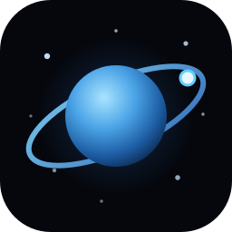
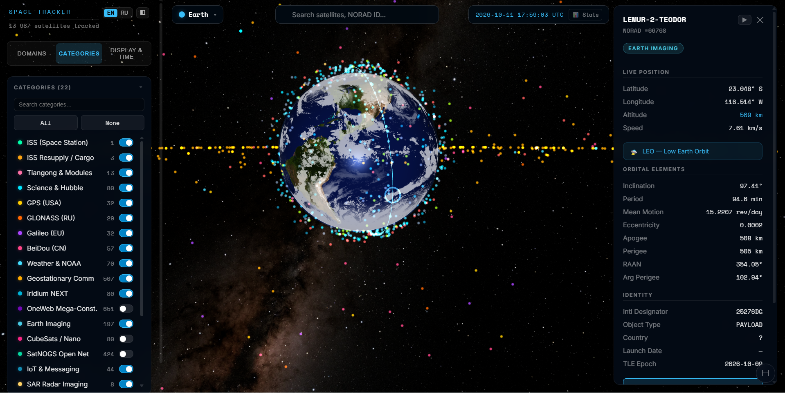
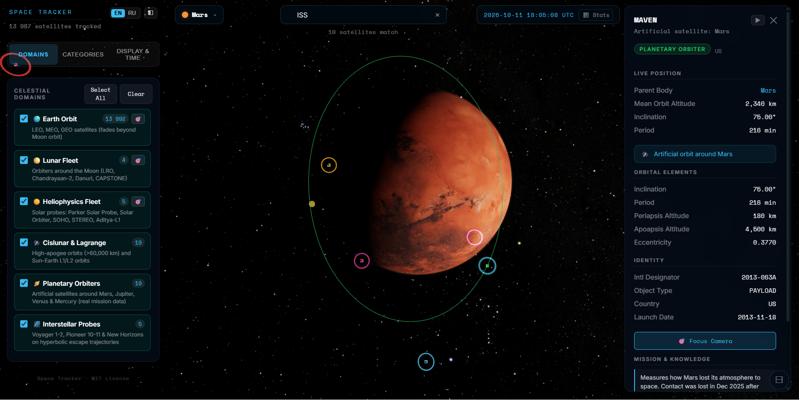
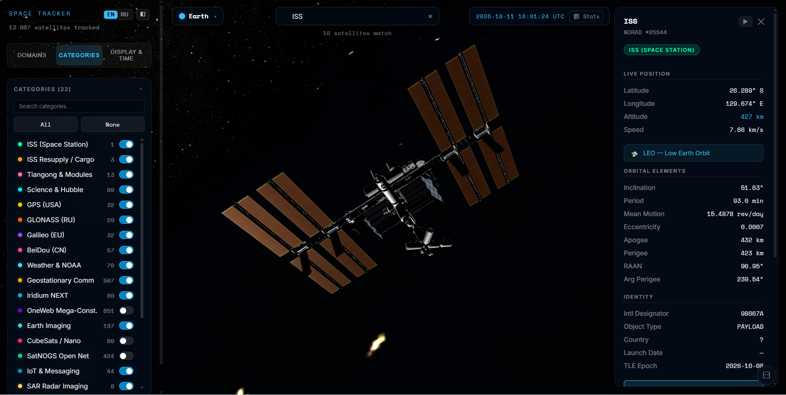
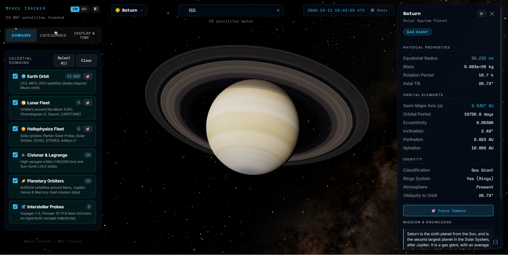
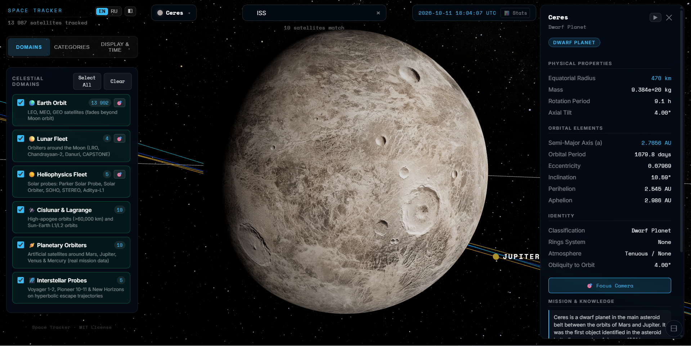
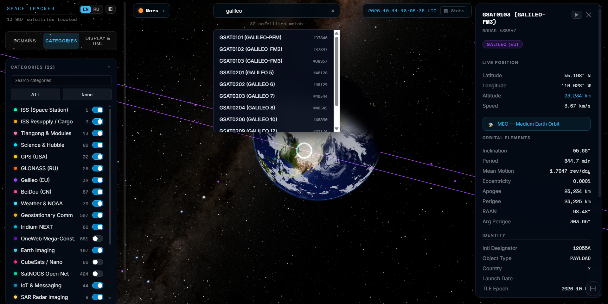
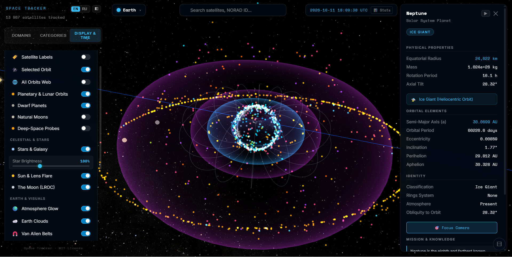

<div align="center">
  
  <h1>Space Tracker</h1>
  <p><b>A real-time 3D visualizer of the Solar System — Earth and its satellites, the planets, moons and dwarf planets, and the spacecraft exploring them.</b></p>
  <p><i>Live catalogue. Accurate orbits. One static bundle.</i></p>

  <p>
    <a href="#-tech-stack"></a>
    <a href="#-rendering-pipeline"></a>
    <a href="#-data-sources--accuracy"></a>
    <a href="#-license"></a>
  </p>
</div>

> [!CAUTION]
> **Accuracy Disclaimer — No Warranty**
> Space Tracker is built from official, public sources — **NASA**, the **European Space
> Agency** and **Wikipedia** — and from established orbital mechanics (SGP4/SDP4, JPL
> ephemerides and SBDB elements). Even so, the author is **not** a scientist or aerospace
> engineer in this field, so **no guarantee of accuracy is made**. Positions, sizes and
> dates are approximations intended for visualization and education, not for any real-world
> decision. The software is provided **"as is", without warranty of any kind**, and you use
> it at your own risk.

---

## 📸 Screenshots

<p align="center">
  <b>Live Earth & Satellite View</b><br>
  
</p>

<div align="center">
  <table>
    <tr>
      <td align="center" width="50%">
        <b>Global Constellation</b><br>
        
      </td>
      <td align="center" width="50%">
        <b>Spacecraft Close-Up</b><br>
        
      </td>
    </tr>
    <tr>
      <td align="center" width="50%">
        <b>Planets & Rings</b><br>
        
      </td>
      <td align="center" width="50%">
        <b>Dwarf Planets & Moons</b><br>
        
      </td>
    </tr>
    <tr>
      <td align="center" width="50%">
        <b>Filters, Search & Controls</b><br>
        
      </td>
      <td align="center" width="50%">
        <b>Satellite Info Panel</b><br>
        
      </td>
    </tr>
  </table>
</div>

---

## 🛰️ What is Space Tracker?

Space Tracker renders the real sky in your browser. It pulls the live CelesTrak
element catalogue, propagates every object with SGP4, and draws it in true
position over a textured, physically lit Earth — then keeps going outward to the
Moon, the eight planets, the dwarf planets and their moons, and the spacecraft
we have sent to them.

It is a **single static bundle**: no backend, no database, no API keys. Point it
at CelesTrak (or a proxy you control) and it runs anywhere a browser does.

## ✨ Features

### 🌍 Live Earth & satellites
* **Live catalogue** — the full CelesTrak GP set across 23 groups (22
  categories, from the ISS and the navigation constellations to Starlink, SAR
  and CubeSats), refreshed on load through an IndexedDB cache with a 1-hour TTL.
* **Real propagation** — SGP4/SDP4 via `satellite.js`, run in **4 Web Workers**
  so the render thread never stalls, with an analytic per-frame pass for the
  selected object.
* **Earth at 8K** — NASA Blue/Black Marble day and night maps, an ocean
  specular mask and toggleable **city night lights**.
* **Live clouds** — a separate cloud shell streamed in near-real time from
  **EUMETSAT** (via *clouds.matteason.co.uk*) in 2K/4K/8K tiers, with a bundled
  static map that stays put if the network drops.
* **Atmosphere** — a scattering limb glow with soft night / morning edges.
* **Van Allen belts** — the inner and outer radiation belts, drawn as McIlwain
  L-shells above the ionosphere from the real tilted dipole (toggleable).
* **Pick & search** — click-to-select via analytic ray-to-point picking, plus
  text search over name, NORAD id, international designator, agency, keywords
  and description.
* **Filters** — toggle any of the 22 categories, or gate the whole scene by
  **celestial domain** (Earth orbit, lunar, heliophysics, cislunar/Lagrange,
  planetary orbiters, interstellar probes) with a one-tap focus per domain.

### 🛰️ Body info panel
* Selecting any object opens a details card with the live geodetic position
  (latitude / longitude / altitude / speed), the orbital elements and regime,
  the raw TLE, mission text pulled live from Wikipedia, official mission links
  and a **Live Radar (N2YO)** link for Earth satellites.

### 🌗 Sun, Moon & the planets
* **Sun** — a physically scaled photosphere with a procedural corona and lens
  flare, correctly occluded by foreground bodies.
* **Moon** — real LROC albedo with a procedural close-up regolith shader, true
  ephemeris, and the lunar orbiter fleet.
* **Planets** — the eight planets plus Pluto, with NASA / Solar System Scope
  equirectangular maps and **lazy LOD tiers** (a 2K base that paints instantly,
  4K/8K streamed in as the camera approaches), Saturn's rings, and correct
  axial tilt, rotation and lighting.
* **Dwarf planets** — nine bodies (Ceres, Orcus, Haumea, Quaoar, Makemake,
  Gonggong, Eris, Sedna, Salacia) on real heliocentric elements from the
  NASA/JPL Small-Body Database.
* **Natural moons** — the major satellites of Jupiter, Saturn, Uranus, Neptune,
  Mars and Pluto from JPL mean elements, kept hidden until you enable them.
* Every body carries its own atmosphere limb where one exists (Earth, Neptune,
  Pluto's blue haze, …).

### 🚀 Fleets & deep space
* **Planetary orbiters** — real artificial satellites around Mars, Jupiter,
  Venus and Mercury (MRO, Mars Odyssey, Juno, …).
* **Lunar fleet** — LRO, Chandrayaan-2, Danuri and CAPSTONE.
* **Heliophysics fleet** — Parker Solar Probe, Solar Orbiter, SOHO, STEREO and
  Aditya-L1.
* **Cislunar & Lagrange** — high-apogee (>60,000 km) and Sun–Earth L1/L2 objects.
* **Interstellar probes** — Voyager 1–2, Pioneer 10–11 and New Horizons, flown
  on real JPL Horizons hyperbolic conics with outbound escape trails.

### 🕒 Time controls
* Speed steps of **1× / 10× / 60× / 600× / 3600×**, a **reverse** toggle and a
  **↺ Now** reset. The whole scene — satellite propagation and every planetary
  ephemeris — advances to the chosen instant, with a live UTC readout.

### 🎛️ Visualization controls
* **Overlays** — satellite labels, the selected orbit, an all-orbits web, and
  the planetary & lunar orbit lines.
* **Sky** — toggle the star field and dial its **brightness**, plus the Sun &
  lens flare and the Moon.
* **Earth & layers** — atmosphere glow, Earth clouds, Van Allen belts, 3D
  satellite models and city night lights.
* **Sliders** — satellite point size and **mouse zoom sensitivity**.
* **Minimal mode** — collapse the UI down to just the scene.

### 🛠️ Crafts & interface
* **Real 3D models** — close-ups of the ISS, the NASA exploratory fleet, the
  A-Train, Landsat, the JPSS weather series, TDRS, the deep-space probes and the
  GLONASS/Galileo constellations, framed at their true physical size.
* **Body selector & labels** — a dropdown across the Sun, Earth, Moon, planets,
  dwarf planets and moons, plus clickable 3D labels on every body.
* **HUD** — a UTC clock with optional live stats (FPS, object count, sim speed,
  memory).
* **Responsive** — a desktop layout and a mobile layout (slide-in sidebar
  drawer, bottom-sheet details) that adapt to the viewport.
* **Bilingual UI** — full **English / Russian** localization.
* **Offline resilience** — stale-cache satellite fallback and cached Wikipedia
  extracts keep it useful when the network drops.
* **Built-in perf probe** — frame-stage timings, FPS, object count and memory
  (`?perf=1`).

---

## 🚀 Quick Start

```bash
git clone https://github.com/Envel-Nikita-Gutsenkov/Space.git
cd Space
npm install

npm run dev        # start the Vite dev server (live CelesTrak data via the dev proxy)
npm run build      # production bundle into dist/
npm run preview    # serve the built bundle locally
npm test           # run the verification suite
```

Open the printed local URL. In development, Vite proxies `/api/celestrak` to
`https://celestrak.org`, so no extra setup is needed.

> [!NOTE]
> A **static production build has no CelesTrak proxy** — the Vite dev proxy is
> development-only. The repo ships a ready-made **Cloudflare Worker** deploy that
> proxies `/api/celestrak/*` at the edge (see
> [`docs/DEPLOY_CLOUDFLARE.md`](docs/DEPLOY_CLOUDFLARE.md)). On any other host,
> route that path to CelesTrak yourself or set
> `VITE_CELESTRAK_BASE_URL=https://celestrak.org`.

### ⚙️ Configuration

Create a `.env` file in the project root to override the defaults:

```env
# Base URL for the CelesTrak GP element service (default: the dev proxy /api/celestrak)
VITE_CELESTRAK_BASE_URL=/api/celestrak

# Base URL for the live cloud-map service (default: https://clouds.matteason.co.uk)
VITE_CLOUD_MAP_BASE_URL=https://clouds.matteason.co.uk
```

### 🎛️ Controls

| Action | Input |
|---|---|
| Orbit the camera | Drag |
| Zoom | Scroll / pinch |
| Select an object | Click a marker, planet or list row |
| Toggle orbits / labels | Sidebar (Display tab) |
| Time travel | Sidebar clock — speed, reverse and reset to now |
| Search | Type in the search box (`Enter` to jump) |
| Reset view | The focus/reset control in the HUD |

---

## 🧩 Tech Stack

| Area | Technology |
|---|---|
| UI | React 18 |
| State | Zustand 4 (single store shared with the Three.js layer) |
| Rendering | Three.js r167, custom GLSL shaders |
| Propagation | `satellite.js` 5 (SGP4/SDP4) in 4 Web Workers |
| Build | Vite 5 |
| Caching | IndexedDB (satellite 1 h TTL, Wikipedia 24 h TTL) |

## 📡 Data Sources & Accuracy

Orbital data is fetched live from authoritative public sources; the app never
invents positions.

| Source | Used for |
|---|---|
| **CelesTrak** GP element sets (TLE/3LE) | All satellite orbits |
| **NASA Visible Earth** | Earth day/night (Blue & Black Marble) |
| **NASA LROC** | Moon albedo |
| **NASA / JHUAPL / SwRI (New Horizons)** | Pluto global colour mosaic |
| **NASA SVS** "Deep Star Maps 2020" (SVS 4851) | Background star sphere |
| **Solar System Scope** (CC BY 4.0) | Planet, ring and dwarf-planet maps |
| **EUMETSAT** via "Live cloud maps" (CC0) | Near-real-time cloud map |
| **Wikipedia** MediaWiki API (CC BY-SA 4.0) | Mission description extracts |
| **NASA/JPL SBDB** and **JPL Planetary Satellite Mean Elements** | Dwarf-planet & moon orbits |
| **NASA 3D Resources** | Spacecraft 3D models |

Propagation is as accurate as SGP4 from public elements gets — tens of
kilometres of along-track error for low Earth orbit, more for high-drag objects
between element updates. Positions are for visualization; **do not** use them
for pointing, avoidance or any operational decision.

The full, per-asset attribution and license list — including required Creative
Commons credits and the EUMETSAT notice *"Contains modified EUMETSAT data"* — is
in [`THIRD-PARTY-NOTICES.md`](THIRD-PARTY-NOTICES.md), and the same information
is shown in the app under **Legal & Attributions**. That file also records the
per-asset terms (share-alike and commercial-use notes included); imagery, models
and fonts are used under their own licenses, and this is an independent,
unaffiliated hobby project.

## 🏗️ Documentation

* [Architecture](docs/ARCHITECTURE.md) — scene graph, workers, data flow, file map.
* [Performance](docs/PERFORMANCE.md) — texture budget, hot paths, LOD strategy.
* [API](docs/API.md) — internal module interfaces.
* [Deployment](docs/DEPLOY_CLOUDFLARE.md) — edge deploy with the CelesTrak proxy.
* [Roadmap](docs/ROADMAP.md) — shipped and planned work, known issues.

## ⚡ Performance

The scene is built to stay smooth on modest hardware: instanced `THREE.Points`
for the catalogue, lazy texture tiers so heavy decodes never land on a wide
view, an LRU model cache, and scratch-vector reuse in the render loop. See
[`docs/PERFORMANCE.md`](docs/PERFORMANCE.md) for the numbers.

## 🗺️ Roadmap

Planned: ground-track projection, pass prediction for a location, a mobile
layout, animated spacecraft close-ups, and an optional WASM propagator. Full
list in [`docs/ROADMAP.md`](docs/ROADMAP.md).

---

## 📜 License

The **source code** of Space Tracker is released under the **MIT License** — see
[`LICENSE`](LICENSE). Copyright © 2026 Space Tracker contributors.

The MIT License covers the code only. Bundled third-party libraries, fonts,
imagery, 3D models and data sources keep their own licenses (MIT, OFL 1.1,
CC BY 4.0, CC BY-SA 3.0/4.0, CC0, Apache 2.0, and public-domain NASA /
US-Government data) and must be reused under those terms. Downscaled or
re-encoded copies of a source map are **derivative works** and carry the
source's license — in particular the **CC BY-SA** maps (Pluto, Ganymede,
Callisto, Phobos, Deimos) remain CC BY-SA as shipped here. Every asset is
credited in [`THIRD-PARTY-NOTICES.md`](THIRD-PARTY-NOTICES.md).

Space Tracker is an independent hobby project, **not affiliated with or endorsed
by** NASA, ESA, EUMETSAT or CelesTrak. Some sources (ESA, EUMETSAT, and the
CC BY and CC BY-SA works) are **not public domain**; non-commercial and
educational use is fine, but commercial or operational use may require separate
permission — re-check each source before monetising. The software is provided
**"as is", without warranty of any kind**. This is not legal advice.

## 🙏 Credits

* **Orbital elements** — CelesTrak and US Space Command; SGP4 by Brandon Rhodes
  (`satellite.js`, Vallado port).
* **Imagery & maps** — NASA, ESA, USGS, JHUAPL/SwRI, EUMETSAT, Solar System
  Scope, Björn Jónsson and Askaniy (per their Creative Commons terms).
* **3D models** — NASA 3D Resources (public domain), and the ISS by
  *"unaipl2003"* on Sketchfab (CC BY 4.0). GLONASS-M and Galileo FOC chassis are
  original procedural models.
* **Libraries** — [Three.js](https://threejs.org), [React](https://react.dev),
  [Zustand](https://github.com/pmndrs/zustand),
  [satellite.js](https://github.com/shashwatak/satellite-js) and
  [Vite](https://vitejs.dev), all MIT.
* **Fonts** — [Space Mono](https://fonts.google.com/specimen/Space+Mono) and
  [Inter](https://fonts.google.com/specimen/Inter) (SIL OFL 1.1, via Google Fonts).
* **Created by** Nikita Gutsenkov — [n.gucenkov@gmail.com](mailto:n.gucenkov@gmail.com).

<p align="center"><i>Built for the love of the sky.</i></p>
